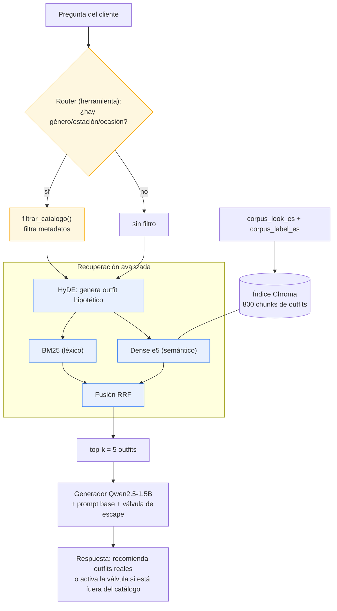

# Módulo 3 — Sistema RAG agéntico: *personal shopper* de moda

Este sistema lee lo que una persona pide con sus propias
palabras ("busco algo elegante y abrigado para una boda en invierno") y le **recomienda conjuntos
de ropa reales de un catálogo**, explicándole por qué encajan. Si le preguntan algo que el catálogo
no sabe (precios, envíos, tallas numéricas), **lo dice en vez de inventar**.

- **Para quién:** el cliente de un e-commerce de moda que escribe por chat a un *personal shopper*.
- **Qué es una buena respuesta:** una recomendación fundamentada en outfits que **existen** en el
  catálogo (los cita por su identificador), coherente con el estilo / ocasión / clima / género
  pedido, y honesta cuando el dato no está.

> Este módulo le da a nuestro modelo el conocimiento del catálogo que no tenía: en el M1 entrenamos
> un extractor de estilo y en el M2 construimos la vara de evaluación; aquí montamos la capa que
> **recupera, actúa y se evalúa** sobre el corpus real. Todo queda envuelto en `sistema(pregunta) →
> respuesta` para que el harness lo llame y para montar encima el M4 (visual) y el M5 (despliegue).

---

## 1. Cómo correrlo (Colab gratuito, reproducible)

1. Abrir `notebooks/M3/rag_sistema.ipynb` en Colab con **GPU T4**.
2. Descomentar y ejecutar la celda de `git clone -b cesar ...` y la de `!pip install`.
3. `Entorno de ejecución → Ejecutar todo`.

Semillas y versiones de modelos están fijadas (`SEED = 42`). **No requiere claves de pago**: el
generador y el juez son modelos locales (Qwen2.5-1.5B). Gemini solo se usó, de forma opcional y
documentada, para traducir el corpus una única vez (el resultado quedó versionado, así que el RAG no
depende de ninguna API).

### Estructura de la carpeta

```
notebooks/M3/
├── rag_sistema.ipynb         # notebook principal (pipeline de punta a punta)
├── README.md                 # este reporte
├── corpus/
│   ├── corpus_look_es.csv     # 800 outfits (español)  ← indexado
│   ├── corpus_label_es.csv    # 3796 prendas (español) ← enriquece cada chunk
│   └── fuente_en/             # originales en inglés + caché de traducción (reproducibilidad)
├── eval/
│   └── eval_set_rag.json      # 12 casos (10 en corpus + 2 fuera de corpus)
└── resultados/
    ├── scorecard_m3.csv           # tabla evolutiva
    ├── scorecard_m3_ablacion.csv  # ablación de técnicas
    └── ragas_m3.csv               # 4 métricas RAGAS
```

---

## 2. Corpus, *chunking* e índice

- **Fuente:** catálogo de outfits de moda de e-commerce (colecciones de mujer y de hombre) tomado del repositorio (https://github.com/recsys-benchmark/FashionStylist/tree/main/Dataset),
  traducido al español con `data_generation/translate_corpus.py`. **Licencia:** datos de uso
  académico para SI4006; corpus derivado y traducido. Los originales en inglés y la caché de
  traducción están en `corpus/fuente_en/` para reproducir la traducción.
- **Tamaño:** **800 documentos** (outfits) y **3796 prendas**. Unidad de indexación: **1 outfit = 1
  chunk** → **800 chunks** en Chroma.

**Tres decisiones justificadas con *nuestro* corpus:**

1. **Chunk = 1 outfit, sin solapamiento.** Cada `look` es una descripción corta y autocontenida de
   un conjunto (1–3 frases) más el detalle de sus prendas; partirlo rompería la unidad "outfit", que
   es justo lo que el usuario pide, así que no hay nada que solapar.
2. **Embeddings `multilingual-e5-small`.** Las consultas son español coloquial y el corpus es
   español descriptivo; un embedding multilingüe pequeño alinea ambos registros y entra en Colab
   gratuito.
3. **top-k = 5.** El usuario quiere **opciones** de conjuntos; con k=5 traemos varios outfits
   comparables sin saturar el prompt del generador pequeño.

---

## 3. Diagrama del pipeline



- **Técnicas avanzadas** (azul): HyDE + búsqueda híbrida (BM25 + dense) con fusión RRF.
- **Herramienta / capa agéntica** (amarillo): el router que decide y `filtrar_catalogo()`.
- El **reranking cross-encoder** se evaluó y se **descartó** por diagnóstico (ver §6).

---

## 4. Las cuatro versiones

| Versión | Qué hace |
|---|---|
| **Línea base M2 (sin RAG)** | El generador responde sin catálogo. Fila de comparación. |
| **`sistema_rag`** (ingenuo) | top-k denso en Chroma + prompt aumentado + válvula de escape. |
| **`sistema_rag_avanzado`** | **Híbrida (BM25+dense, RRF) + HyDE**. Misma firma que el ingenuo. |
| **`sistema`** (final, agéntico) | Avanzado **+ herramienta** de filtro de metadatos. |

**Capa agéntica — herramienta `filtrar_catalogo`:**
- **Esquema:** `gender ∈ {De mujer, De hombre, Unisex}`, `season ∈ {Primavera, Verano, Otoño,
  Invierno}`, `occasion ∈ {Escuela, Hogar, Eventos sociales, Viaje, Trabajo, Deporte}`.
- **Router:** mapeo determinista por palabras clave (reproducible) con respaldo LLM y **parseo
  tolerante a errores** del JSON (si viene mal, se ignora el filtro).
- **Tope de pasos:** máximo 1 decisión de herramienta por consulta (sin bucles posibles).
- **Cuándo se usa / cuándo no** (evidencia real):

  | Consulta | ¿Usa herramienta? | Filtro |
  |---|---|---|
  | ropa de hombre estilo techwear para el frío | **Sí** | `{gender: De hombre, season: Invierno}` |
  | un vestido de mujer para un evento social formal | **Sí** | `{gender: De mujer, occasion: Eventos sociales}` |
  | algo bohemio y colorido para el día a día | Sí (de más) | `{gender: De hombre}` |
  | quiero verme elegante | **No** | `{}` |

  **Hallazgo honesto:** en "algo bohemio y colorido" la herramienta se activó **de más** (detectó
  "para el día a día" → género por una palabra ambigua). Es un falso positivo del router por
  palabras clave; lo reportamos como lo que es.

---

## 5. Tabla evolutiva (mismo eval set, misma vara)

Eval set: **12 casos** (10 en corpus + 2 fuera de corpus → válvula de escape). Mismo generador, mismo
prompt base y mismo juez en las 4 filas (*delta limpio*). Dimensiones re-instanciadas para QA (ver §7).

| Sistema | D1 · citación de outfits | D2 · juez (1–5) | D3 · dominio | Latencia mediana |
|---|---|---|---|---|
| 1. Línea base M2 (sin RAG) | 0.167 | 4.75 | 0.75 | 4.65 s |
| 2. RAG ingenuo | **0.917** | 4.33 | 0.75 | 8.29 s |
| 3. RAG avanzado (híbrida+HyDE) | 0.833 | **4.67** | **0.833** | 13.81 s |
| 4. Sistema final (con herramienta) | 0.75 | 4.00 | 0.667 | 12.23 s |

- **D1 (métrica clásica):** fracción de outfits citados que existen y fueron recuperados (en casos
  fuera de corpus puntúa 1 si NO cita, que es lo correcto).
- **D2 (juez):** Qwen2.5-1.5B con rúbrica 1–5 de calidad de recomendación.
- **D3 (dominio):** cumple el `criterion` del caso (juez ≥ 4) **+ regla dura de válvula** fuera de corpus.

### Ablación (quitar una técnica a la vez)

| Variante | D1 | D2 | D3 | Latencia |
|---|---|---|---|---|
| **final (híbrida + HyDE)** | 0.833 | **4.67** | **0.833** | 13.89 s |
| solo dense | **0.917** | 4.33 | 0.75 | 8.39 s |
| híbrida sin HyDE | 0.833 | 4.67 | 0.75 | 8.32 s |
| con reranking (descartado) | 0.833 | 4.58 | 0.667 | 13.27 s |

---

## 6. Tabla RAGAS (implementación propia, juez Qwen2.5 local)

Calculada con **implementación propia** de las 4 métricas (la librería `ragas` da conflictos de
dependencias irresolubles en Colab; el enunciado permite "la implementación del laboratorio de la
sesión 10 con su propio juez"). **Juez: Qwen2.5-1.5B local**; similitudes con el embedder e5 local.

| Sistema | faithfulness | answer relevancy | context precision | context recall |
|---|---|---|---|---|
| RAG ingenuo | 0.654 | 0.893 | 0.783 | 0.75 |
| Sistema final (con herramienta) | 0.519 | 0.90 | 0.783 | 0.50 |

---

## 7. Lectura honesta (las cuatro preguntas)

### 7.1 ¿Qué movió qué?

- **El RAG mueve la métrica clave:** D1 (citación de outfits reales) salta de **0.167** (línea base)
  a **0.917** (RAG ingenuo). La línea base no conoce el catálogo y por eso casi no cita outfits
  reales; el RAG los recupera y los cita. Esto es la prueba numérica de que **anclar al catálogo es
  el aporte real del RAG**.
- **HyDE sube la calidad:** en la ablación, pasar de "híbrida sin HyDE" a "híbrida + HyDE" sube D3 de
  **0.75 a 0.833** (y mantiene D2 en 4.67). HyDE acerca las consultas cortas/vagas a las
  descripciones ricas del catálogo.
- **El reranking resta:** "con reranking" baja D3 a **0.667** (vs 0.833 sin él) y baja D2 a 4.58. Por
  eso **se descartó** del sistema final. Es un hallazgo por diagnóstico, no por catálogo.

### 7.2 ¿Cuánto costó?

- RAG ingenuo: **8.3 s** mediana. RAG avanzado: **13.8 s** (HyDE añade una llamada extra al LLM, el
  mayor costo). El reranking costaba +5 s **para empeorar** el puntaje: doble razón para quitarlo.
- **¿Vale la pena para el usuario?** HyDE **sí** (sube D3/D2 por +5 s). El reranking **no**. La
  herramienta agéntica no añade latencia relevante, pero (ver abajo) tampoco mejora el agregado.

### 7.3 ¿Qué falla queda y de qué tipo es? (separada con RAGAS)

- **context precision alta (0.78)** en ambos sistemas → la recuperación trae chunks **relevantes**.
- **context recall cae en el sistema final (0.75 → 0.50)** → **problema de recuperación inducido por
  la herramienta**: al filtrar por metadatos, el router restringe el espacio de búsqueda y a veces
  deja fuera el mejor outfit (sobre todo cuando los metadatos del corpus no son perfectos: hay
  outfits unisex y alguna etiqueta de género imperfecta). Esto explica, con números, por qué el
  **sistema final baja** frente al avanzado en la tabla evolutiva.
- **faithfulness moderada (0.65 ingenuo, 0.52 final)** → **problema de generación**: el generador
  pequeño (Qwen 1.5B) a veces añade detalles no sustentados por el contexto (p. ej. describe un
  abrigo como "marrón oscuro" cuando el dato real es "caqui"). La fuente de verdad son los datos de
  `corpus_label_es.csv`, no la prosa del modelo; en producción se mostrarían las prendas desde los
  datos.

**Conclusión de diseño (honestidad sobre los resultados):** el **mejor sistema es el RAG avanzado
(híbrida + HyDE)**. La **herramienta agéntica, aunque funciona y cumple el requisito** (esquema,
parseo tolerante, tope de pasos, se usa/no se usa correctamente), **no mejora el harness en el
agregado** de este eval set porque su filtro sacrifica recall. Lo dejamos integrado y lo reportamos
tal cual: *recordando la sesión 10, "no todo necesita un agente"*. La herramienta es útil cuando el
usuario impone una restricción dura (solo hombre, solo invierno), pero en consultas generales conviene
no filtrar.

### 7.4 ¿Qué pasó con las preguntas fuera del corpus? (válvula de escape)

Los 2 casos fuera de corpus (envíos/tiempos y tallas numéricas/devoluciones) **activaron la válvula
de escape** correctamente ("No encuentro esa información en el catálogo"), sin inventar precios ni
tallas. La regla dura de D3 verifica esto por diseño. En un hallazgo previo, el generador pequeño
**disparaba la válvula de más** en casos en-corpus; se mitigó reforzando el prompt (reglas separadas:
recomendar vs. válvula), y tras el ajuste recomienda con normalidad cuando hay outfits.

---

## 8. Mínimos del enunciado (checklist)

- [x] Corpus real del dominio + pipeline de indexación ejecutable + 3 decisiones justificadas.
- [x] RAG ingenuo con válvula de escape (línea base, no se borra).
- [x] **≥ 2 técnicas** avanzadas por diagnóstico: **híbrida (BM25+dense, RRF) + HyDE**
      (+ reranking evaluado y descartado).
- [x] **≥ 1 herramienta** con esquema, parseo tolerante y tope de pasos; casos de uso/no-uso.
- [x] Harness del M2 (3 dimensiones, misma firma) + eval set ≥ 10 casos, ≥ 2 fuera de corpus.
- [x] **4 métricas RAGAS** (con contexto y referencia por caso), juez declarado (Qwen2.5 local).
- [x] Lectura honesta: qué movió qué, cuánto costó, qué falla queda, qué pasó con la válvula.
- [x] Corre en Colab gratuito, sin claves de pago; semillas y versiones fijadas.

---

## 9. Uso de IA

Usamos un asistente de IA (Kiro, sobre modelos Claude) para **co-desarrollar** el notebook del RAG,
el script de traducción del corpus (`data_generation/translate_corpus.py`) y la redacción de este
reporte. **El equipo tomó todas las decisiones de diseño** y las validó corriendo el sistema:
elección y traducción del corpus, las tres decisiones de chunking/embeddings/top-k, la selección de
técnicas **por diagnóstico** (y la decisión de **descartar el reranking** al ver la ablación), la
re-instanciación de la vara para QA (métrica de citación de outfits), y la lectura honesta de los
resultados. Revisamos cada salida del modelo, depuramos los errores de entorno (Chroma, versiones de
RAGAS) y confirmamos cada número de las tablas ejecutando el notebook en Colab.

> Nota: los modelos que forman parte del sistema (generador, juez y embeddings = Qwen2.5-1.5B y
> multilingual-e5-small; y Gemini usado una sola vez para traducir el corpus) no cuentan como uso de
> IA en la construcción; esta sección es sobre cómo armamos la entrega.
